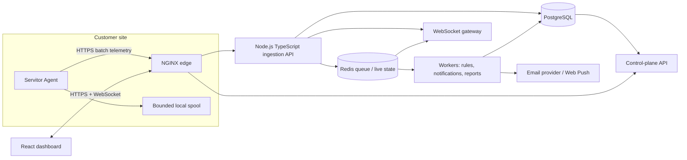

# Servitor
## Product & Architecture Blueprint

**Investor and engineering briefing · v1 foundation / v2 vision**  
**Positioning:** lightweight infrastructure observability with a thermal protection layer for on-premise and hybrid SMEs.

> **Investment thesis:** Servitor turns a small, inexpensive local agent into an early-warning system for the servers businesses cannot afford to lose. It combines machine-level telemetry, thermal incident workflows, and a clear operational dashboard without requiring an enterprise observability team or a heavyweight monitoring stack.

## 1. Startup pitch and value proposition

### The problem

SMEs increasingly depend on a few on-premise or hybrid servers for line-of-business software, identity, storage, and customer operations. Those systems often sit in small server rooms with limited cooling redundancy and limited 24/7 IT coverage. A fan failure, blocked airflow, cooling fault, or sustained workload spike can go unnoticed until performance degrades or hardware shuts down. The result is avoidable downtime, emergency replacement costs, data-recovery work, and lost customer confidence.

Many monitoring products are designed for large platform teams: they can be expensive to operate, broad in scope, and noisy for a small IT team. Lightweight tools may expose metrics without turning a rising temperature into an accountable, actionable incident.

### The Servitor answer

Servitor continuously collects temperature, CPU, memory, and heartbeat signals from a local agent, evaluates risk close to the machine, and makes current health and incident history visible in one web dashboard. Configurable warning and critical thresholds trigger deduplicated alerts and a workflow that records who is responding and what they did.

The product is designed around three customer outcomes:

1. **Earlier intervention:** surface thermal risk while there is still time to inspect cooling, airflow, fans, or workload.
2. **Lower monitoring overhead:** deploy a small agent and manage a fleet through a focused SaaS control plane.
3. **Operational accountability:** move from an alert to an acknowledged incident with notes and an auditable resolution trail.

### Differentiation and measurable product targets

- **Low overhead:** agent design target below **1% average CPU** and **50 MB resident memory** on supported hardware. Treat these as benchmarked service objectives, not universal guarantees; publish results by OS, sensor driver, hardware class, and sampling interval.
- **Fast warning:** target **under five seconds** from a qualifying local sample to alert dispatch when the host is online and the delivery provider is healthy. The end-to-end path depends on sampling cadence, network connectivity, queue health, and provider latency; the agent should also enforce local safety behavior where configured.
- **Useful at a glance:** a live fleet view shows temperature, CPU, memory, last heartbeat, current severity, and incident state without requiring users to assemble dashboards.
- **Built for mixed estates:** begin with supported Linux hosts and a clear sensor compatibility matrix; expand to Windows, virtual machines, and container discovery as product evidence supports it.

**Value proposition:** *Know when a server is heating up, understand which systems are at risk, and give your team a short path from warning to action.*

## 2. Core features and functional capabilities

### 2.1 Servitor Agent

A signed, versioned Go agent is the recommended first implementation. Go provides straightforward cross-compilation, a compact deployment model, mature HTTP/TLS libraries, and efficient concurrency. Rust is a credible alternative if memory safety and a tighter runtime footprint prove more important than implementation speed. Keep the collection interface modular so the language choice does not couple sensor support to the cloud protocol.

Agent responsibilities:

- Collect temperature from supported hardware and OS sensor interfaces, plus CPU and memory utilization, at a configurable cadence.
- Attach host identity, agent version, sample time, sequence number, and metric quality/source metadata.
- Buffer a bounded amount of telemetry on disk during network interruptions; retry with exponential backoff and jitter, preserving ordering where practical and dropping oldest low-priority samples at the configured limit.
- Send batches over authenticated TLS, with compressed payloads and idempotent event identifiers. Never let an unbounded queue consume host storage.
- Expose local logs and health diagnostics without putting secrets in logs.
- Support secure enrollment, key rotation, graceful upgrade, and uninstall. Keep credentials in OS-protected storage where available and restrict file permissions.

The agent should report missing or unsupported sensors explicitly. Temperature values must include sensor identity and units; the backend must not silently interpret a missing sensor as a safe temperature.

### 2.2 Thermal and hardware alerting

Users configure warning and critical thresholds per host, host group, or policy profile. Initial rules should support temperature thresholds with a sustained-duration condition, hysteresis for recovery, and optional CPU/memory rules. Thresholds should be validated against the host's reported sensor range and clearly labeled as customer policy rather than a universal hardware-safe limit.

Alert lifecycle:

`Normal → Warning → Critical → Acknowledged / In Progress → Resolved`

- Evaluate samples against the active versioned policy. Persist each state transition and its cause.
- Deduplicate repeated notifications by host, rule, and incident window. Redis can hold short-lived suppression state; PostgreSQL remains authoritative for incident state.
- Apply cooldowns and recovery hysteresis so values oscillating near a threshold do not spam users or flap the incident state.
- Deliver through Web Push and email, with retry, delivery status, and dead-letter handling. Acknowledge that browser push depends on permission and supported browser behavior; email is the durable fallback.
- Make delivery asynchronous after durable event acceptance. A successful API response means accepted for processing, not necessarily delivered to a mailbox or device.

Servitor is an alerting and response aid. It should not claim guaranteed hardware protection: sensor availability, firmware behavior, cooling design, and network reachability vary by environment. Any local shutdown or control action should be opt-in, bounded, and separately approved by the customer.

### 2.3 Real-time command dashboard

The web dashboard provides a tenant-scoped fleet overview, host detail, live telemetry, threshold status, agent version, and last-seen time. A host is marked offline after **more than three minutes without a heartbeat** (configurable with a minimum guardrail); recovery is recorded as a state transition. Distinguish offline from stale telemetry and from a missing sensor.

Use WebSockets for updates to subscribed tenant and host rooms. Authenticate the connection, authorize every subscription, and re-check access when credentials or membership change. On reconnect, clients fetch a fresh snapshot and resume live updates; WebSockets are an acceleration path, not the system of record.

### 2.4 Incidents, audit trail, and reports

- Incident history records trigger, severity changes, acknowledgement, assignee, action notes, resolution, and delivery attempts with timestamps and actor identity.
- “In Progress” requires an authenticated analyst action and an optional assignee. Notes are append-only audit entries; corrections should be new entries rather than silent edits.
- Generate PDF uptime and analytics reports asynchronously from a consistent time window. Include the uptime definition, data gaps, timezone, report generation time, and filters so a percentage is not misrepresented.
- Reports may contain infrastructure details. Enforce tenant authorization, short-lived download links, retention controls, and audit logging for generation and access.

### 2.5 Security, roles, and governance

Use tenant-scoped RBAC with least privilege:

| Capability | IT Manager | Support Analyst | Tenant Admin |
|---|---:|---:|---:|
| View fleet, incidents, analytics | Yes | Yes | Yes |
| Acknowledge and add action notes | Optional policy | Yes | Yes |
| Configure thresholds and alert routes | No | Yes | Yes |
| Manage users, roles, agent enrollment | No | No | Yes |

This resolves the initial role brief into an explicit policy: managers receive read-only analytics by default; analysts configure thresholds and manage incident response; a tenant admin owns membership, enrollment, and organization settings. Customers may choose a stricter policy.

Security baseline:

- TLS 1.3 for supported client and service connections, modern cipher suites, certificate lifecycle automation, and HSTS at the public edge. Internal transport should also be encrypted where deployment boundaries warrant it.
- Short-lived JWT access tokens with issuer, audience, expiry, and key identifier validation; rotate signing keys. Use refresh-token rotation and revocation for browser sessions. Do not put long-lived agent credentials in user JWTs.
- Give each agent a revocable device credential scoped to one tenant and host. Enrollment tokens are single-use and expire quickly.
- Enforce tenant scoping in every API and data-access path. Use PostgreSQL row-level security as defense in depth where practical, plus application authorization checks.
- Encrypt data at rest using managed database/storage encryption; define retention and deletion policies for telemetry, audit records, and reports.
- Maintain immutable audit events for role changes, policy edits, enrollment, acknowledgements, and report access. Apply rate limits, request validation, secret redaction, dependency patching, and backup/restore procedures.

## 3. System architecture and technology choices

### 3.1 Logical architecture

This is a decoupled client-server system with event-driven processing. The agent communicates outbound, avoiding inbound firewall rules at customer sites. The control plane accepts telemetry, validates identity and schema, records durable data, and emits events for asynchronous rule evaluation, notifications, and report generation.

### 3.2 Ingestion and event flow

1. Agent samples sensors and stamps each batch with a host ID, sequence, collection time, and idempotency key.
2. NGINX terminates public TLS, applies request size and rate limits, and forwards to stateless API instances.
3. API authenticates the device, validates tenant/host binding and payload bounds, then durably records accepted samples or a durable ingestion event before acknowledging. Redis alone must not be the only copy of accepted telemetry.
4. A worker evaluates policies, updates incident transitions transactionally, and enqueues notification intents with deduplication keys.
5. Notification workers deliver Web Push/email with bounded retries. They record attempts and provider outcomes without blocking ingestion.
6. The WebSocket gateway publishes compact state changes. Clients reconcile from the API after reconnect.

For an MVP, PostgreSQL can be the durable event and metadata store, with a transactional outbox feeding Redis-backed workers. At higher write volume, partitioned telemetry tables or a dedicated message broker can be introduced based on measured throughput. Avoid introducing Kafka or a time-series database before retention, query, and scale requirements justify the operational cost.

### 3.3 Recommended stack

| Layer | Choice | Reason and guardrail |
|---|---|---|
| Agent | Go (initial), Rust as evaluated alternative | Small deployable binary, efficient collection and networking; validate footprint on representative machines. |
| Edge | NGINX | TLS termination, request limits, routing, health checks, and WebSocket proxying. Keep application authorization in the service. |
| Backend | Node.js + TypeScript + Express | Fast iteration and shared API contracts; keep ingestion stateless, validate schemas at boundaries, and move CPU-heavy work to workers. |
| Primary persistence | PostgreSQL | Tenant, user, host, policy, incident, audit, report metadata, and queryable historical telemetry. Partition/retention strategy follows measured volume. |
| Live state / queue | Redis | Presence, short-lived suppression keys, cache, pub/sub or job queues. Treat as ephemeral; persist authoritative incidents and events in PostgreSQL. |
| Web client | React + Tailwind CSS | Responsive fleet and incident UI, role-aware navigation, accessible status treatment. |
| Mobile | React Native (later) | Reuse API contracts for push and incident response; web dashboard remains the initial operational surface. |
| Live transport | WebSockets | Near-real-time fleet changes with snapshot reconciliation and tenant-scoped authorization. |

### 3.4 Data model and tenancy

Core entities: `Tenant`, `User`, `Membership`, `Host`, `AgentCredential`, `MetricSample`, `Policy`, `Incident`, `IncidentEvent`, `Notification`, `AuditEvent`, and `Report`. Each customer-owned row carries `tenant_id`; host identifiers are globally unique or unique within tenant with explicit tenant binding. Index common queries by `(tenant_id, host_id, observed_at)` and `(tenant_id, status, updated_at)`.

Metric samples should retain source time and server receive time. This supports offline backfill, late-arriving sample handling, clock-skew detection, and transparent uptime calculations. Define a default retention tier and offer longer retention as an explicit plan capability. Aggregations can preserve useful history while limiting raw data growth.

### 3.5 Reliability and operations

- Horizontally scale stateless API and WebSocket instances; isolate workers by job type and use bounded concurrency.
- Add health/readiness checks, structured logs with correlation IDs, metrics for ingest latency, queue age, delivery success, heartbeat lag, and database saturation.
- Define service objectives before selling guarantees. Suggested initial internal objectives: telemetry acceptance availability, alert dispatch latency percentile, and notification delivery success measured separately from provider acceptance.
- Use managed PostgreSQL backups with point-in-time recovery, tested restore drills, Redis persistence only where useful, and documented recovery objectives.
- Apply database migrations with backward-compatible expand/migrate/contract steps. Roll out agent updates in rings with rollback and version visibility.
- Protect against noisy tenants with per-tenant quotas, batch limits, API rate limits, and queue fairness.

### 3.6 Deployment model

Start with a managed cloud control plane in one region, isolated by tenant authorization and encrypted storage. Deploy API, worker, WebSocket, PostgreSQL, and Redis as independently scalable services behind NGINX or a managed edge. Offer a customer-hosted or private deployment only when demand and support capacity justify its added upgrade and observability burden. The local agent remains outbound-only and tolerates temporary disconnection through bounded buffering.

## 4. Product roadmap: v1 to v2.0

### Foundation / v1

1. Linux agent enrollment and health reporting, sensor compatibility inventory, bounded offline spool, and authenticated telemetry ingestion.
2. Fleet dashboard, three-minute offline status, host detail, and temperature/CPU/RAM history.
3. Warning/critical policies, incident deduplication and hysteresis, email/Web Push delivery, and acknowledgement with notes.
4. Tenant RBAC, audit trail, operational dashboards, retention controls, and PDF reporting.
5. Benchmark agent footprint and end-to-end alert latency under defined test conditions; document supported OS/hardware combinations.

### v2.0 vision: three differentiated bets

1. **Predictive thermal anomaly detection.** Learn each host’s normal thermal profile by workload, ambient pattern, and time. Detect unusual rate-of-rise and cooling degradation before a fixed threshold is crossed. Start with explainable statistical baselines and confidence indicators; use machine learning only when labeled fleet data and customer consent support it. Provide a reason and contributing signals for every prediction.
2. **Safe automated remediation.** Offer customer-authored, signed webhooks or scripts for approved actions such as opening a ticket, notifying facilities, reducing a workload, or invoking a maintenance runbook. Require per-action permissions, dry-run mode, approval gates for disruptive actions, timeout/rollback behavior, and a complete audit trail. Keep thermal shutdown behavior disabled by default.
3. **Environment discovery and service context.** Discover Docker/container workloads and selected cloud or hypervisor inventory through least-privilege connectors. Map host heat and resource pressure to the workload or service affected, while keeping infrastructure credentials scoped, encrypted, and revocable. Begin with read-only discovery before any orchestration control.

### Commercial proof points

Track pilots against a small set of evidence: time from threshold breach to alert dispatch, proportion of alerts acknowledged within the customer’s target, reduction in unobserved thermal events, agent resource overhead by host class, and report/export usage. These metrics substantiate the product promise and inform packaging without implying that every alert prevents an outage.

## Strategic summary

Servitor occupies a focused wedge in infrastructure monitoring: smaller teams need the signal that a critical machine is becoming thermally unsafe, plus a simple way to act on it. The architecture keeps collection lightweight and local, preserves accepted telemetry durably, and separates ingestion from alert and reporting work. That gives Servitor a credible path from an SME-ready thermal monitor to a broader, context-aware infrastructure protection platform.

